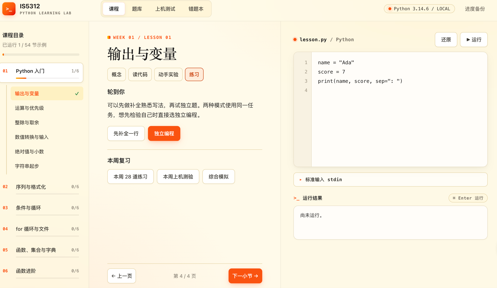
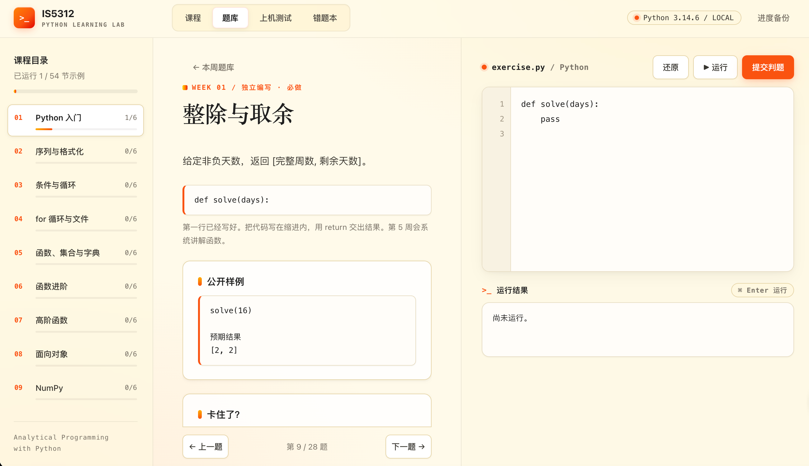
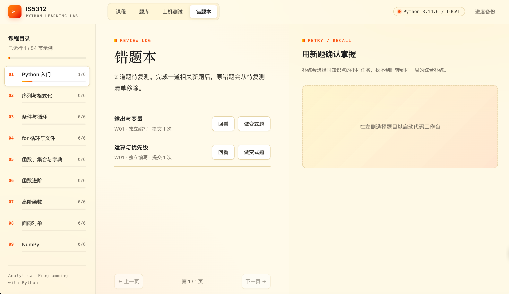

# IS5312 Python 学习工作台


面向 **IS5312 Analytical Programming with Python** 的本地 Web 学习工具。从第一个 Python 程序开始，用可运行示例、逐行讲解和自动判题练到面向对象、NumPy、Pandas 和 Matplotlib。



## 快速开始

需要 Python 3.10 或更新版本，以及 NumPy、Pandas 和 Matplotlib。本项目在 macOS、Python 3.14.6、NumPy 2.5.4、Pandas 3.1.1 和 Matplotlib 3.11.2 上通过验证。

```bash
git clone https://github.com/Maropion03/is5312-learning-lab.git
cd is5312-learning-lab
python3 -m venv .venv
source .venv/bin/activate
python -m pip install numpy pandas matplotlib
python server.py
```

在浏览器打开 [学习工作台](http://127.0.0.1:8531/)。服务在终端前台运行，按 `Ctrl+C` 停止。安装好依赖后，也可以在 Finder 双击 [启动学习工作台.command](启动学习工作台.command)，脚本会优先使用项目的 `.venv`。

## 学习方式

1. 从「课程」选择知识点，依次翻阅 **概念、读代码、动手实验、练习** 四页。桌面端可同时查看课程、编辑器和输出。
2. 在右侧运行原示例，预测改动后的结果，再载入实验验证。原示例和实验分别保存代码草稿。
3. 用补全、调试和独立编程练习。点击「运行」执行公开样例，点击「提交判题」检查多组输入。
4. 每周做一次上机测验。交卷后可回看失败用例和参考解法，并从错题本跳转补练。

题库、上机测试和错题本每页最多显示 6 条。打开题目后，可以用底部的「上一题／下一题」继续浏览当前筛选结果、试卷或错题队列。

浏览器本地保存页码、代码草稿、成绩和错题。「进度备份」可以导出和导入 JSON。使用同一浏览器和地址即可续学。

## 界面截图

### 编程练习



### 错题本



## 课程与题库

| 周次 | 内容 |
| --- | --- |
| 1–3 | Python 基础、字符串与序列、分支与循环 |
| 4–6 | 遍历与文件、函数与集合字典、递归与推导式 |
| 7–9 | 高阶函数、面向对象、NumPy |
| 10 | Pandas 的 Series 与 DataFrame、表格读取、缺失值与去重、值映射、排序和分组统计 |
| 11 | Matplotlib 折线、类别图、直方图、DataFrame 散点图和 GDP 子图 |

- **66 节课程**。第 1–7 周可查阅配套代码与详细讲义，第 8–11 周的可运行示例按课程课件主题编写。
- **374 道分周题目**。每周 28 道练习、6 道周测，其中 14 道标为核心题。部分补全题和独立编程题共用题意。
- **9 道独立综合模拟题**。范围为第 1–9 周，第 10、11 周各有独立周测。
- **33 道课后作业改编题**。在顶部「课后作业」查看第 2–11 周的可判题练习与自检。其中 Week 11 含 NBA 汇总与 IQR 清洗。
- **本地课程文件**。下载杂项的各周文件夹及 Week 11 的八个散放文件通过本地服务访问。可用 `IS5312_ASSIGNMENT_DIR` 指定资料目录。GitHub 版本包含课程实现和可运行的小型示例数据。本地有原始文件时，网站优先使用原始数据。
- **图形输出**。Matplotlib 示例用 `savefig("chart.png")` 生成图形，点击运行后会在右侧显示。

## 项目结构与验证

| 路径 | 内容 |
| --- | --- |
| [web/](web/) | 学习页面、编辑器、翻页和进度管理 |
| [server.py](server.py)、[runner.py](runner.py) | 本地服务和 Python 执行判题，支持标准输入、样例文件、NumPy、Pandas 和 Matplotlib |
| [lesson_notes.py](lesson_notes.py)、[bank.py](bank.py) | 逐行讲解、动手实验、题库编排 |
| [sources/](sources/) | 第 1–7 周配套代码与讲义 |

安装依赖后运行 `python verify_bank.py`，可检查 66 节课程的逐行讲解与实验，以及 416 道题的 1,152 组参考用例。服务监听本机回环地址，代码通过本机 Python 进程执行。
